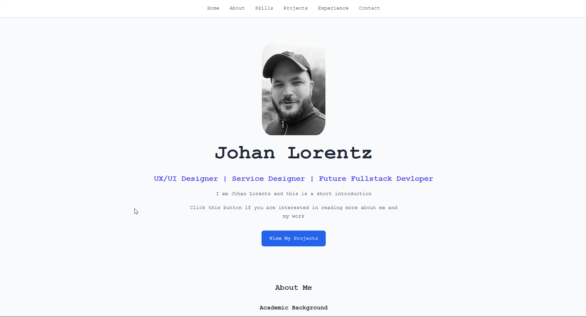
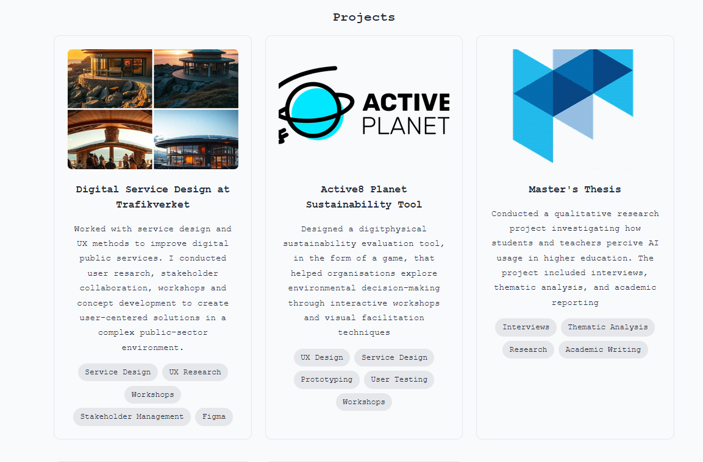
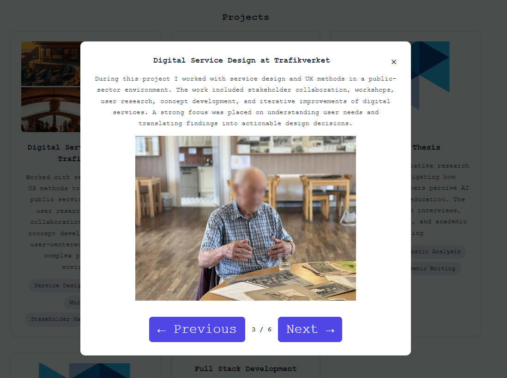

# Personal Portfolio Website

## Project Description

This project is a personal portfolio website built with React and Vite. The purpose of the website is to showcase my background, skills, projects, and professional experience in UX Design, Service Design, and Full Stack Development.

The portfolio was developed as part of the Full Stack Development program and demonstrates both frontend development skills and React fundamentals.

---

## Features

- Responsive design for desktop, tablet, and mobile devices
- Navigation between sections
- Hero section with introduction and call-to-action
- Skills section generated dynamically using React
- Project gallery with project images
- Interactive project modal with image navigation
- Experience section
- Contact call-to-action
- Project cards built as reusable React components

---

## Technologies

- React
- Vite
- JavaScript
- HTML
- CSS
- Git
- GitHub

---

## Installation

Clone the repository:

```bash
git clone https://github.com/lorriluring/portfolio-johan.git
```

Move into the project folder:

```bash
cd portfolio-johan
```

Install dependencies:

```bash
npm install
```

---

## How to Run

Start the development server:

```bash
npm run dev
```

Open the local development URL displayed in the terminal.

---

## Screenshots

### Home Page



### Projects Section



### Project Modal



---

## Team Members

### Johan Lorentz

- GitHub: https://github.com/lorriluring

---

## Future Improvements

- Add more detailed project case studies
- Add GitHub and live demo links to projects
- Improve project gallery navigation
- Add dark mode support
- Add additional projects as development experience grows
